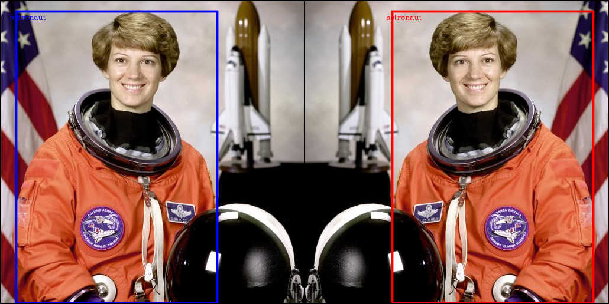
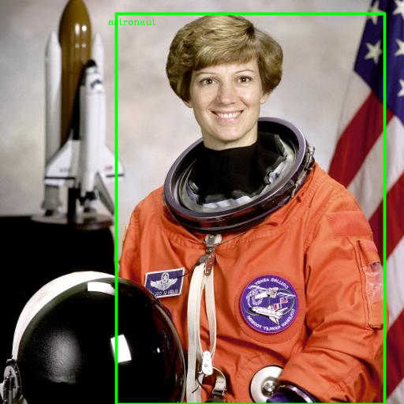
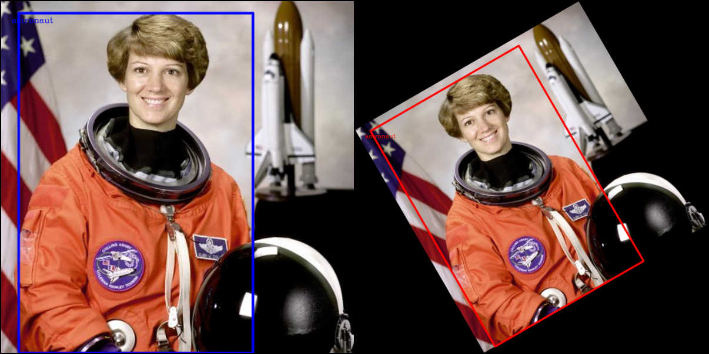
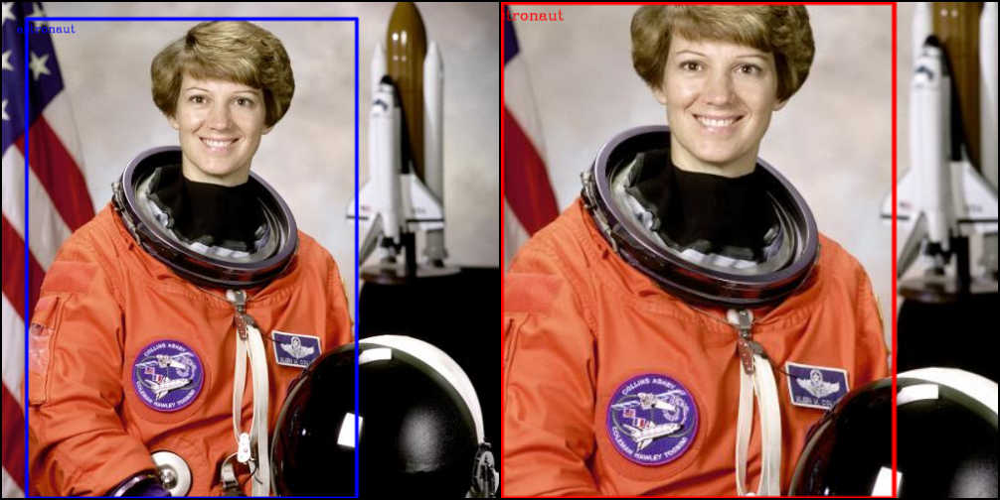
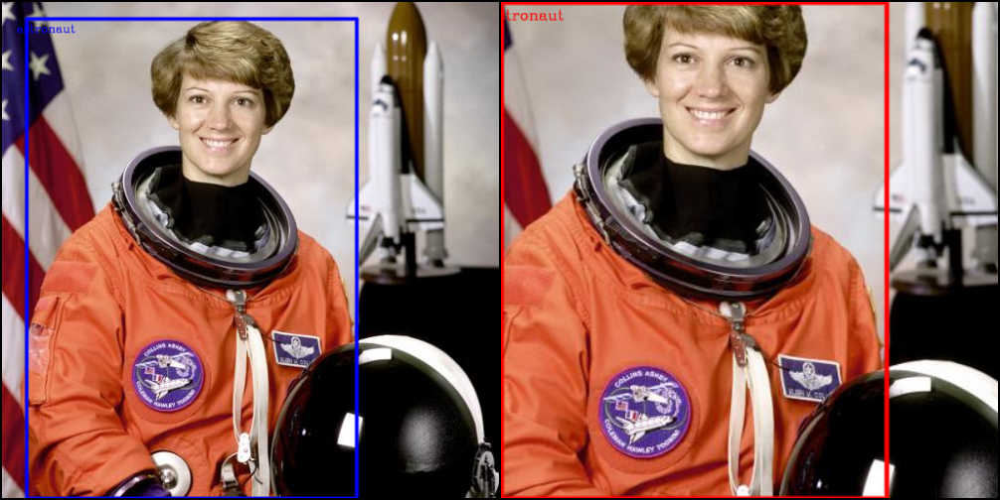
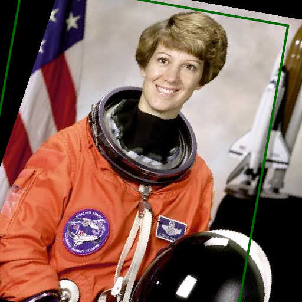
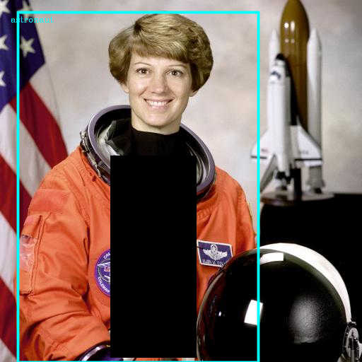

```{r, echo = FALSE}
knitr::opts_chunk$set(eval = FALSE)
```

This article illustrates how to use torchvision **item transforms** to preprocess images together with their annotations (bounding boxes, segmentation masks, ...). It follows the same story as the [Getting started with transforms v2](https://docs.pytorch.org/vision/main/auto_examples/transforms/plot_transforms_getting_started.html) tutorial from PyTorch vision.

## Setup

```{r setup}
library(torchvision)
library(torch)

gallery <- "https://raw.githubusercontent.com/pytorch/vision/main/gallery/assets/"
img <- base_loader(paste0(gallery, "astronaut.jpg")) |> transform_to_tensor()
print(img, n=3)
```

```{torch_tensor}
(1,.,.) = 
Columns 1 to 9  0.5804  0.4392  0.2863  0.2392  0.3098  0.4235  0.5098  0.5490  0.6118
  0.6980  0.5882  0.4667  0.4353  0.4941  0.5804  0.6392  0.6627  0.6667
... [the output was truncated (use n=-1 to disable)]
[ CPUFloatType{3,512,512} ]

```

We are now ready with a square color image tensor of 512 by 512 pixels.

## The basics

Regular transforms (e.g. `transform_hflip()`) operate on image tensor (a single image or in a batch). Item transforms go further: they transform **both** the image and its associated target in a consistent way, so that bounding boxes remain aligned with the objects they annotate, and masks stay in sync with the pixels they describe.

Let us start with a simple example -- horizontally flipping an image that carries bounding boxes.

```{r create-detection-item}
# Build a detection item manually
boxes <- torch_tensor(matrix(c(
  #        xmin ymin xmax ymax
            25,   17, 365, 512
), ncol = 4, byrow = TRUE), dtype = torch_float())

det_item <- list(
  x = img,
  y = list(boxes = boxes, labels = "astronaut",
           image_height = img$shape[2], image_width = img$shape[3])
)
class(det_item) <- c("image_with_bounding_box", "list")
```

Now apply `item_transform_hflip()`:

```{r basic-hflip}
flipped <- item_transform_hflip(det_item)

before <- draw_bounding_boxes(det_item, colors = "blue", width = 5)
after  <- draw_bounding_boxes(flipped,  colors = "red",  width = 5)

tensor_image_browse(vision_make_grid(before, after, per_row = 2))
```

{alt-text="transform_hflip illustration of a dog bounding-box"}The image is mirrored and the bounding-box x-coordinates are adjusted so the boxes stay on the astronaut.

## Classification pipelines

If you only care about image classification, standard transforms are all you need:

```{r classification-pipeline}

out <- img |>   
  transform_random_resized_crop(size = c(224, 224)) |> 
  transform_random_horizontal_flip(p = 0.5) |> 
  transform_normalize(mean = c(0.485, 0.456, 0.406),
                      std  = c(0.229, 0.224, 0.225))
  

tensor_image_browse(torchvision:::.min_max_scale(out))
```

{alt-text="illustration of transforms applied to the astronaut image only"}

The rest of this article focuses on **item transforms** that pair an image with its detection or segmentation target.

## Object detection with bounding boxes

### Horizontal flip

`item_transform_hflip()` flips the image and mirrors the bounding-box x-coordinates.

```{r det-hflip}
flipped <- item_transform_hflip(det_item)

before <- draw_bounding_boxes(det_item, colors = "blue", width = 5)
after  <- draw_bounding_boxes(flipped,  colors = "red",  width = 5)

tensor_image_browse(vision_make_grid(before, after, per_row = 2))
```

{alt-text="blue bbox astronaut on the left, with both image with red bbox horizontal flipped on the right"}

### Random horizontal flip

`item_transform_random_horizontal_flip()` applies the flip with a given probability, useful during training augmentation.

```{r det-rhflip}
detected <- item_transform_random_horizontal_flip(det_item, p = 1)
# p = 1 guarantees the flip for the demo

after <- draw_bounding_boxes(detected, colors = "green", width = 5)
tensor_image_browse(after)
```

{alt-text="randomly flipped astraunot image with green bbox"}

### Rotation

`item_transform_rotate()` rotates the image and the bounding boxes around the image centre. By default the canvas is expanded so the full rotated image is visible (no cropping).

```{r det-rotate}
rotated <- item_transform_rotate(det_item, angle = 30)

before <- draw_bounding_boxes(det_item, colors = "blue", width = 5)
after  <- draw_bounding_boxes(rotated,  colors = "red",  width = 5)

before <- transform_resize(before, c(600, 600))
after  <- transform_resize(after, c(600, 600))

tensor_image_browse(vision_make_grid(before, after, per_row = 2))
```

{alt-text="blue bbox astronaut on the left, with with both image with red bbox rotated on the right"}

### Random rotation

`item_transform_random_rotation()` draws a random angle from a given range.

```{r det-rrotate}
det_rotated <- item_transform_random_rotation(det_item, degrees = 30)

after <- draw_bounding_boxes(det_rotated, colors = "orange", width = 5)
tensor_image_browse(after)
```

{alt-text="randomly rotated astronaut image with orange rotated bbox"}

### Crop

`item_transform_crop()` crops a rectangular region and adjusts the bounding boxes to remain correct within the cropped image.

```{r det-crop}
cropped <- item_transform_crop(det_item, top = 50, left = 50,
                               height = 400, width = 400)

before <- draw_bounding_boxes(det_item, colors = "blue", width = 5)
after  <- draw_bounding_boxes(cropped,  colors = "red",  width = 5)

before <- transform_resize(before, c(500, 500))
after  <- transform_resize(after, c(500, 500))

tensor_image_browse(vision_make_grid(before, after, per_row = 2))
```

{alt-text="blue bbox astronaut on the left, with both image with red bbox cropped on the right"}


### Center crop

`item_transform_center_crop()` takes a centre crop of the specified size.

```{r det-ccrop}
ccropped <- item_transform_center_crop(det_item, size = c(400, 400))

before <- draw_bounding_boxes(det_item, colors = "blue", width = 5)
after  <- draw_bounding_boxes(ccropped,  colors = "red",  width = 5)

before <- transform_resize(before, c(500, 500))
after  <- transform_resize(after, c(500, 500))

tensor_image_browse(vision_make_grid(before, after, per_row = 2))
```

{alt-text="blue bbox astronaut on the left, with both image with red bbox center-cropped on the right"}
### Random resize crop

`item_transform_random_resize_crop()` crops a random area, then resizes to the target size -- a common training augmentation.

```{r det-rresize-crop}
rrc <- item_transform_random_resize_crop(det_item, size = c(300, 300))

after <- draw_bounding_boxes(rrc, colors = "purple", width = 5)
tensor_image_browse(after)
```
{alt-text="randomly resized and cropped astronaut image with purple bbox"}

### Random affine

`item_transform_random_affine()` draws a random rotation, translation, scale and shear, then applies the affine transformation to both image and boxes.

```{r det-rafine}
affine <- item_transform_random_affine(det_item, degrees = 20,
                                       translate = c(0.1, 0.1),
                                       scale = c(0.9, 1.1), shear = 10)

after <- draw_bounding_boxes(affine, colors = "darkgreen", width = 5)
tensor_image_browse(after)
```
{alt-text="random affine transform on astronaut image and the darkgreen bbox"}

### Random perspective

`item_transform_random_perspective()` applies a random perspective warp with a given distortion scale.

```{r det-rpersp}
persp <- item_transform_random_perspective(det_item, distortion_scale = 0.5, p = 1)

after <- draw_bounding_boxes(persp, colors = "brown", width = 5)
tensor_image_browse(after)
```
{alt-text="random perspective transform on astronaut image and the brown bbox"}

### Random erasing

`item_transform_random_erasing()` erases a random rectangular patch of the image. The bounding boxes are **not** modified -- only the pixels change.

```{r det-rerase}
erased <- item_transform_random_erasing(det_item, p = 1)

after <- draw_bounding_boxes(erased, colors = "cyan", width = 5)
tensor_image_browse(after)
```
{alt-text="random perspective transform on astronaut image and the cyan bbox"}

### Affine (deterministic)

`item_transform_affine()` applies a specific affine transformation specified by the user.

```{r det-affine}
affined <- item_transform_affine(det_item, angle = 15,
                                 translate = c(30, 20),
                                 scale = 0.7, shear = 5, fill = 255)

after <- draw_bounding_boxes(affined, colors = "magenta", width = 5)
tensor_image_browse(after)
```
{alt-text="affine transform on astronaut image and the magenta bbox"}

### Perspective (deterministic)

`item_transform_perspective()` applies a user-specified perspective transformation.

```{r det-persp}
H <- img$shape[2]
W <- img$shape[3]
startpoints <- list(c(0, 0), c(W, 0), c(W, H), c(0, H))
endpoints   <- list(c(50, 30), c(W - 40, 10), c(W - 20, H - 30), c(30, H - 20))

persped <- item_transform_perspective(det_item, startpoints, endpoints)

after <- draw_bounding_boxes(persped, colors = "navy", width = 5)
tensor_image_browse(after)
```

### Resize

`item_transform_resize()` resizes the image and rescales the bounding box coordinates by the same factor.

```{r det-resize}
resized <- item_transform_resize(det_item, size = c(300, 400))

after <- draw_bounding_boxes(resized, colors = "red", width = 5)
tensor_image_browse(after)
```

### Pad

`item_transform_pad()` pads the image on all sides and shifts the bounding box coordinates accordingly.

```{r det-pad}
padded <- item_transform_pad(det_item, padding = 50)

after <- draw_bounding_boxes(padded, colors = "red", width = 5)
tensor_image_browse(after)
```

## Semantic segmentation with masks

Segmentation items carry per-pixel masks alongside the image. Item transforms apply the same geometric operation to both the image and the masks.

```{r create-seg-item}
# Build a synthetic segmentation item
H <- img$shape[2]
W <- img$shape[3]

# Two masks: one for the dog region, one for the background
mask1 <- torch_zeros(H, W, dtype = torch_bool())
mask1[100:400, 50:350] <- TRUE

mask2 <- torch_zeros(H, W, dtype = torch_bool())
mask2[150:450, 200:500] <- TRUE

masks <- torch_stack(list(mask1, mask2))

seg_item <- list(
  x = img,
  y = as_segmentation_target(list(masks = masks, labels = c(1L, 2L)))
)
class(seg_item) <- c("image_with_segmentation_mask", "list")
```

### Horizontal flip

```{r seg-hflip}
flipped <- item_transform_hflip(seg_item)

before <- draw_segmentation_masks(seg_item, alpha = 0.5)
after  <- draw_segmentation_masks(flipped,  alpha = 0.5)

tensor_image_browse(vision_make_grid(before, after, per_row = 2))
```

### Random horizontal flip

```{r seg-rhflip}
flipped <- item_transform_random_horizontal_flip(seg_item, p = 1)

after <- draw_segmentation_masks(flipped, alpha = 0.5)
tensor_image_browse(after)
```

### Rotation

```{r seg-rotate}
rotated <- item_transform_rotate(seg_item, angle = 30)

before <- draw_segmentation_masks(seg_item, alpha = 0.5)
after  <- draw_segmentation_masks(rotated,  alpha = 0.5)

before <- transform_resize(before, c(600, 600))
after  <- transform_resize(after, c(600, 600))

tensor_image_browse(vision_make_grid(before, after, per_row = 2))
```

### Random rotation

```{r seg-rrotate}
rotated <- item_transform_random_rotation(seg_item, degrees = 30)

after <- draw_segmentation_masks(rotated, alpha = 0.5)
tensor_image_browse(after)
```

### Crop

```{r seg-crop}
cropped <- item_transform_crop(seg_item, top = 50, left = 50,
                               height = 400, width = 400)

before <- draw_segmentation_masks(seg_item, alpha = 0.5)
after  <- draw_segmentation_masks(cropped,  alpha = 0.5)

before <- transform_resize(before, c(500, 500))
after  <- transform_resize(after, c(500, 500))

tensor_image_browse(vision_make_grid(before, after, per_row = 2))
```

### Random resize crop

```{r seg-rresize-crop}
rrc <- item_transform_random_resize_crop(seg_item, size = c(300, 300))

after <- draw_segmentation_masks(rrc, alpha = 0.5)
tensor_image_browse(after)
```

### Random affine

```{r seg-rafine}
affine <- item_transform_random_affine(seg_item, degrees = 20,
                                       translate = c(0.1, 0.1),
                                       scale = c(0.9, 1.1), shear = 10)

after <- draw_segmentation_masks(affine, alpha = 0.5)
tensor_image_browse(after)
```

## Combining item transforms with datasets

Item transforms can be applied directly to a dataset object, wrapping its `.__getitem__` method so that every access returns a transformed item:

```{r dataset-usage}
ds <- pascal_detection_dataset(root = tempdir(), download = TRUE,
                               split = "trainval")

# Wrap the dataset so every item is horizontally flipped
ds_flipped <- item_transform_hflip(ds)

item <- ds_flipped[1]
draw_bounding_boxes(item, colors = "yellow", width = 5) |>
  tensor_image_browse()
```

## Summary

| Transform | Detection (boxes) | Segmentation (masks) |
|------------------------|------------------------|------------------------|
| `item_transform_hflip` | Box x-coords adjusted | Masks flipped |
| `item_transform_vflip` | Box y-coords adjusted | Masks flipped |
| `item_transform_rotate` | Boxes rotated around centre | Masks rotated |
| `item_transform_crop` | Boxes cropped & clipped | Masks cropped |
| `item_transform_center_crop` | Boxes adjusted for centre crop | Masks centre-cropped |
| `item_transform_resize` | Boxes rescaled | Masks resized (nearest) |
| `item_transform_pad` | Box coords shifted | Masks padded |
| `item_transform_affine` | Boxes affine-transformed | Masks affine-transformed |
| `item_transform_perspective` | Boxes perspective-warped | Masks perspective-warped |
| `item_transform_random_*` | Same as deterministic variant | Same as deterministic variant |

Item transforms ensure that geometry is applied consistently to both image and annotations, so you never have to worry about boxes drifting out of sync with the pixels they annotate.
